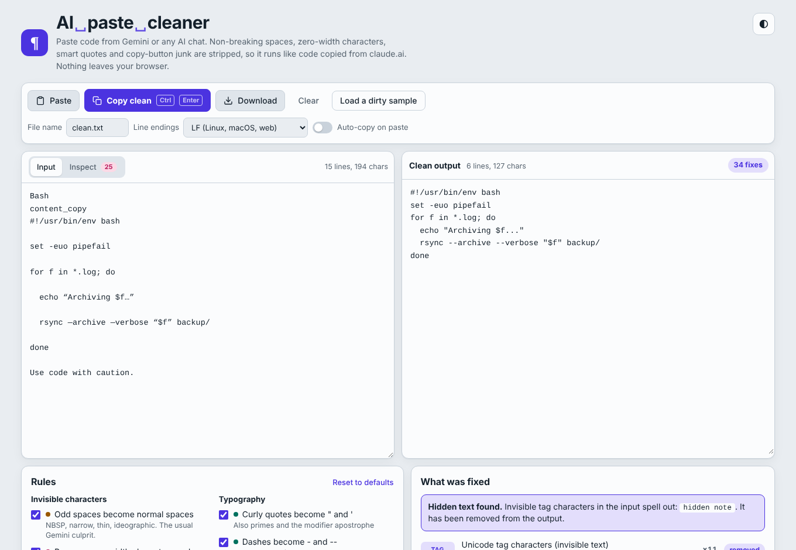

# AI Paste Cleaner

Clean code copied from Gemini (or any AI chat) so it pastes and runs like code copied from claude.ai.

**Live:** https://j0p3s.github.io/AI-Paste-Cleaner/



Code copied out of Gemini's code boxes often carries characters you can't see: non-breaking spaces instead of normal spaces, zero-width characters, curly quotes, em dashes in place of `--`, and leftover UI text like `content_copy` or "Use code with caution." The result looks fine but breaks in bash, Python, PowerShell or `.cmd` scripts. This page fixes all of that in one paste.

It is a single self-contained `index.html`. No build step, no dependencies, no network requests. Everything runs locally in your browser and works offline.

## Features

- **Odd spaces become normal spaces:** NBSP, narrow, thin, figure and ideographic spaces (the usual Gemini culprit).
- **Invisible characters removed:** zero-width space/joiner, word joiner, BOM, soft hyphen, control characters.
- **Text-direction marks removed:** LRM, RLM and bidi overrides that can disguise code ("Trojan Source").
- **Hidden tag text detected:** invisible Unicode tag characters are decoded, shown to you, then removed.
- **Typography fixed:** curly quotes become `"` and `'`, `–` becomes `-`, `—` becomes `--` (repairs mangled `--flags`), `…` becomes `...`.
- **Copy-button junk removed:** "Use code with caution." (English, Portuguese, Spanish, French, Italian, German), `content_copy`, "Copy code", and a lone language header like `Bash` on the first line.
- **Double-spaced paste fixed:** detects a blank line wedged after every line and removes it.
- **Whitespace tidied:** trailing spaces trimmed, blank lines trimmed at start and end.
- **Optional rules:** remove ``` fences, remove line numbers, collapse blank lines, tabs to spaces, strip accents, fullwidth to ASCII, final newline.
- **Safe by default:** emoji ZWJ sequences (👨‍💻) and flag tag sequences are kept; accents are kept unless you turn on stripping.

## Usage

1. Open the page (or `index.html` locally).
2. Paste anywhere on the page (Ctrl+V), click **Paste**, or drop a file on the input.
3. Click **Copy clean** or press **Ctrl+Enter** (⌘+Enter on macOS).

Extras:

- **Inspect** tab highlights every problem character in place, with its code point on hover.
- **What was fixed** lists each change with counts.
- **Auto-copy on paste** cleans and copies in one step.
- **Line endings:** CRLF (Windows) by default, or LF. Naming the download `*.sh`, `*.py` or another Unix-style file switches to LF automatically; `*.cmd` / `*.bat` switch back to CRLF. Downloads are UTF-8 without BOM.
- Rule choices, theme and settings are remembered in your browser.

## Run locally

Just open `index.html` in any modern browser. Nothing to install.

## Tests

The cleaning rules have a small Node test suite:

```bash
node tests/core.test.js
```

## Host it yourself

Fork the repo and enable GitHub Pages (Settings → Pages → Deploy from branch → `main` / root).

## Português

Limpa código copiado do Gemini (ou de outro chat de IA) para que funcione como o código copiado do claude.ai. Remove espaços não separáveis, caracteres de largura zero, aspas curvas, travessões e o texto dos botões de cópia ("Use o código com cuidado."). É um único `index.html`, corre tudo no browser e funciona offline. Cola, carrega em **Copy clean** (ou Ctrl+Enter) e está pronto.

## License

[MIT](LICENSE)
